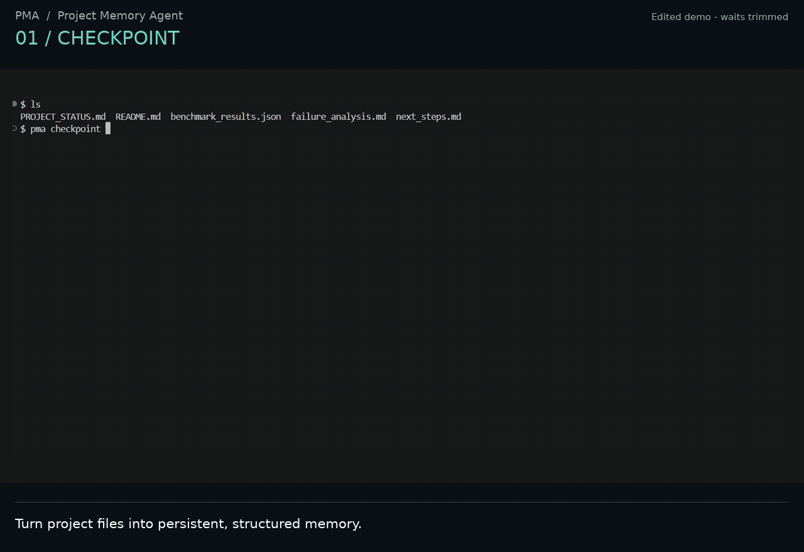
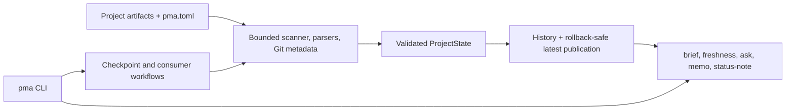

# Project Memory Agent

Project Memory Agent (PMA) is a local CLI that turns a project directory into a
structured, persistent checkpoint. It helps engineers and researchers recover
what is known, what changed, what remains uncertain, and what to do next.

**Reduced context-recovery time by 65% in a small human evaluation across five
engineering and mathematics repositories.** See the [method, raw anonymized
results, and limitations](docs/developer-evaluation.md).

<p align="center">
  
</p>

The recording shows the real CLI workflow with typing and model wait time
trimmed. PMA builds bounded, source-marked memory instead of indexing an entire
repository into an unbounded retrieval layer.

## Engineering highlights

- **Evidence-bounded state:** deterministic parsers create `SOURCE`-marked
  notes before an LLM derives a validated `ProjectState`; bounded lookup then
  supports source-backed questions.
- **Failure-safe publication:** checkpoints are built and validated in
  isolation, successful runs enter immutable history, and `latest/` uses a
  backup/rollback sequence that preserves the prior usable snapshot on failure.
- **Conservative freshness:** Git metadata and artifact manifests distinguish
  `current`, `stale`, `unknown`, and `no_checkpoint` without calling an LLM.
- **Safe scanning:** supported text artifacts are bounded by type, count, size,
  and configured scope; Python AST extraction is structural, opt-in, and never
  imports project code.

## Quick start

PMA requires Python 3.10 or newer. Install from the repository:

```bash
pip install -e .
```

Set `OPENAI_API_KEY` for the LLM-backed `checkpoint` and `ask` commands, then:

```bash
pma checkpoint --project-dir .
pma brief --project-dir .
pma ask --project-dir . "What should I work on next?"
pma freshness --project-dir .
```

`checkpoint` writes the default history to `.project_memory/`; `brief` and
`freshness` are deterministic and read-only. For command semantics, storage
layouts, `memo`, `status-note`, and custom output locations, see the
[CLI guide](docs/cli.md).

Run the complete offline smoke without an API key or network call:

```bash
python demo/offline/run_smoke.py --non-interactive
```

It creates a checkpoint from a synthetic project, checks its health, answers a
bounded source-backed question, changes an input, and detects stale memory.
The [live demo guide](demo/live/README.md) provides the recorded product flow.

## Architecture



The tracked project and generated checkpoint storage are separate. The default
layout is:

```text
.project_memory/
  latest/
  runs/<UTC-microsecond-run-id>/
  failed_runs/<run-id>/
```

Construction happens under a private `.building/` directory. Publication is
failure-safe, with backup/rollback protection, but PMA does **not** claim strict
cross-platform atomic visibility for an entire directory tree. Read the
[architecture](docs/architecture.md) and [accepted design decisions](docs/decisions/README.md)
for ownership, data flows, and failure boundaries.

## Evaluation and reliability

The human timing study recorded 107 baseline minutes and 37 PMA-assisted
minutes across five anonymized repositories: a 65.42% reduction by pooled time
(65.01% as the simple mean of per-repository reductions). It is a small,
descriptive evaluation, not evidence of population-wide performance. The
[developer evaluation](docs/developer-evaluation.md) publishes the raw table,
formula, protocol that can be supported by available records, correctness
rubric status, and missing experimental metadata.

Separate public synthetic suites exercise query/memo behavior, status notes,
Python source extraction, Git-aware state, and freshness reliability. They are
deterministic regression checks, not human-study results. See the
[eval methodology](evals/README.md), [benchmark methodology](benchmarks/README.md),
and [dogfooding case study](docs/case-study-pma-dogfooding.md).

**Engineering reliability:** More than 400 automated test and deterministic
evaluation checks cover architecture boundaries, failure-safe checkpoint
publication, freshness detection, privacy, resource budgets, packaging, and
end-to-end workflows. GitHub Actions runs them across Python 3.10–3.13.

## Documentation

- [CLI, installation, commands, and storage](docs/cli.md)
- [Architecture and failure boundaries](docs/architecture.md)
- [Scanner safety, `pma.toml`, budgets, and Python AST extraction](docs/scanner.md)
- [Git context and freshness](docs/freshness.md)
- [Human developer evaluation](docs/developer-evaluation.md)
- [Public eval suites](evals/README.md)
- [Scalability benchmarks](benchmarks/README.md)
- [Development and release checks](CONTRIBUTING.md)
- [Changelog](CHANGELOG.md)
- [Project status](PROJECT_STATUS.md)

## Limitations

- PMA is a local CLI prototype, not an autonomous coding agent.
- LLM-assisted extraction, queries, semantic diff, live evals, and optional
  judge mode can produce variable outputs.
- `ask` and `memo` use derived checkpoint memory and bounded source excerpts;
  they do not perform arbitrary repository-wide RAG.
- Python awareness is opt-in and structural; PMA does not analyze function
  bodies or runtime behavior. Checkpoint publication is rollback-safe but not
  strictly atomic across platforms.

See the [architecture](docs/architecture.md) for detailed design trade-offs.

## License

Project Memory Agent is available under the [MIT License](LICENSE).
