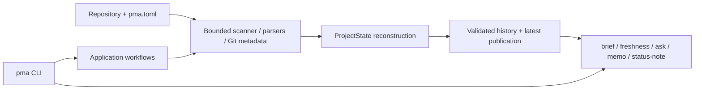

# Project Memory Agent

Project Memory Agent is a local CLI for turning a project directory into a
structured, queryable memory checkpoint.

It scans selected artifacts from a tracked project directory, builds
deterministic parsed notes with source markers, asks an LLM to derive a
validated `ProjectState`, and stores checkpoint history in a separately
resolved output layout. You can then ask questions or generate compact re-entry
and group-update memos from the latest checkpoint.

This is the v0.1.1 reliability baseline: useful enough to dogfood, still
explicit about its limits, and now guarded by transactional checkpoint
publication, resource budgets, manifest-based non-Git freshness, release
privacy checks, and Python 3.10–3.13 CI. Earlier phases added clean-install
release smoke, scanner dogfooding, deterministic status-note evaluation,
bounded Python structure extraction, and bounded checkpoint-time Git metadata.
P2 adds an enforced architecture contract, accepted design decisions, a public
dogfooding case study, a deterministic offline smoke, and an engineered live
demo with versioned fixtures and acceptance criteria.
The version number describes the repository state; it does not claim that
v0.1.1 has been published.

## See PMA work

For the presentation-grade workflow—including a 30–45 second silent storyboard,
a 2–3 minute narrated script, a synthetic Git repository, exact commands, and
gold expectations—start with the [live demo guide](demo/live/README.md).

The repository intentionally does not embed a GIF until a real live run has
been rehearsed, privacy-reviewed, and recorded.

## Run the offline smoke in one command

After installing the repository, run the deterministic end-to-end walkthrough:

```bash
python demo/offline/run_smoke.py
```

This CI-safe smoke creates a real checkpoint from a synthetic project, verifies it with brief,
answers one bounded SOURCE-backed question, changes a source file, and detects
that the checkpoint is stale. It requires no API key and makes no network call;
fixed responses are injected only at the two LLM boundaries. See
[`demo/offline/README.md`](demo/offline/README.md) for its deterministic
contract. It is a reliability check, not the recorded product demo.

## Why it exists

Research and engineering projects often accumulate status across notes, eval
outputs, logs, and half-finished threads. The hard part is not only saving
files; it is recovering the current state:

- What is the project goal?
- What findings are confirmed versus tentative?
- What changed since the last checkpoint?
- What next actions were actually recorded?
- What evidence supports the current conclusions?

Project Memory Agent keeps that state in a structured checkpoint rather than a
chat transcript.

## Core workflow

```text
project artifacts
  -> scanner
  -> deterministic parsers
  -> combined_notes.md with SOURCE markers
  -> LLM-derived project_state.json
  -> checkpoint_summary.md and project_state_card.md
  -> progress_since_last.md
  -> pma ask / pma memo
```

The tracked project and generated checkpoint storage are separate concepts.
The backward-compatible default history layout is:

```text
.project_memory/
  latest/
  runs/<UTC-microsecond-run-id>/
  failed_runs/<run-id>/
```

`latest/project_state.json` is the current-state authority for query and memo
commands. Raw source artifacts are not reopened by `ask` or `memo`; evidence
comes from derived checkpoint memory and bounded SOURCE-marked snippets.

Checkpoint construction occurs under a private `.building/` directory. A run
is validated before it enters immutable history, and failed construction is
moved to `failed_runs/` with bounded stage/error metadata. `latest/` is replaced
through a prepared sibling plus backup/rollback sequence, so a copy or rename
failure preserves the previous usable snapshot. This is a failure-safe
directory transaction; PMA does not claim strict cross-platform atomic
visibility for an entire directory tree. Legacy `--output-dir` replacement
uses the same preserve-old-output contract.

Checkpoint storage can instead be inside the project under another name or
outside it entirely. Commands resolve locations in this order:

1. An explicit `--latest-dir` for commands that consume a checkpoint.
2. A complete `--base-output-dir` and `--project-name` pair.
3. The default `<project-dir>/.project_memory` root.

Relative `--latest-dir` paths resolve under `--project-dir`, preserving the
status-note convention. Relative `--base-output-dir` paths use normal CLI
working-directory semantics. Use matching location arguments for checkpoint
generation and every command that consumes that checkpoint.

The legacy producer form remains available for compatibility:

```bash
pma checkpoint --project-dir . --output-dir ./checkpoint-artifacts
```

In legacy mode the output directory itself contains checkpoint artifacts and
does not contain `latest/` or `runs/`. Consumers read it with
`--latest-dir ./checkpoint-artifacts`. `--output-dir` cannot be combined with
the named history arguments.

## Installation

Create a Python environment and install the package in editable mode:

```bash
pip install -e .
```

For development and deterministic evals, install the optional tools:

```bash
pip install -e '.[dev]'
```

Or install runtime dependencies manually and use the development invocation:

```bash
pip install openai pydantic python-dotenv
PYTHONPATH=src python -m pma ...
```

Create a local `.env` file when using LLM-backed commands:

```text
OPENAI_API_KEY=your_api_key
```

Do not commit `.env`.

## Main commands

The normal product workflow uses configured LLM access for `checkpoint` and
`ask`; unlike the offline demo, these commands require an API key:

```bash
pma checkpoint --project-dir .
pma brief --project-dir .
pma ask --project-dir . "What should I work on next?"
pma freshness --project-dir .
```

Create or update a checkpoint:

```bash
pma status-note --project-dir . --from-latest
pma status-note --project-dir . --from-latest --latest-dir .project_memory/latest
pma status-note --project-dir . --from-latest --write

pma checkpoint \
  --project-dir . \
  --project-name my-project \
  --base-output-dir . \
  --semantic-diff

pma freshness \
  --project-dir . \
  --project-name my-project \
  --base-output-dir .
```

Inspect checkpoint health without changing the project:

```bash
pma brief --project-dir .
pma brief --project-dir . --json

pma brief \
  --project-dir . \
  --project-name my-project \
  --base-output-dir .
```

Ask latest checkpoint memory:

```bash
pma ask "What are the confirmed findings?"
pma ask "What changed since the last checkpoint?"
pma ask --sources "What evidence supports the confirmed findings?"
```

Create a personal re-entry memo:

```bash
pma memo --type self
```

Create a latest-only group update:

```bash
pma memo --type group-update
```

Create windowed group updates:

```bash
pma memo --type group-update --last 5
pma memo --type group-update --since 2026-07-01
```

Use `--project-dir PATH` with `ask` or `memo` when you are outside the tracked
project directory. For custom storage, these commands also accept the matching
`--latest-dir` or `--base-output-dir` plus `--project-name` arguments.

`pma status-note` is a deterministic helper for maintaining checkpoint-friendly
Markdown such as `PROJECT_STATUS.md`. By default it prints a TODO template.
Pass `--from-latest` to prefill from the resolved latest checkpoint and
`--write` to write the note. Existing files are not overwritten unless
`--force` is passed. `PROJECT_STATUS.md` remains a project artifact under
`--project-dir`, even when checkpoint storage is external. Use matching layout
arguments with `--from-latest` for non-default storage.

### Checkpoint health brief

`pma brief` is a deterministic checkpoint-maintenance check, not a project
recap. It inspects the resolved latest checkpoint, reuses the existing
freshness comparison, checks whether `PROJECT_STATUS.md` was modified after the
checkpoint, and returns one maintenance recommendation. It is read-only,
OpenAI-free, does not inspect full Git diffs, and never runs checkpoint or
updates the status note. Use `--json` for the structured schema. Missing, stale,
unknown, incomplete, and invalid health outcomes are ordinary results and exit
successfully.

The two re-entry workflows remain separate:

```text
pma brief
  -> maintain the checkpoint if needed

pma memo --type self
  -> recover project content
```

Use `pma memo --type self` when you need findings, decisions, failures, open
questions, and next actions from checkpoint memory. `pma brief` intentionally
does not display those fields.

## Command semantics

| Command | Purpose | Main inputs |
|---|---|---|
| `brief` | Read-only checkpoint health and maintenance recommendation | latest completeness + freshness + status-note timing |
| `status-note` | Draft checkpoint-friendly Markdown status | optional latest checkpoint memory |
| `checkpoint` | Build latest checkpoint and history run | selected project artifacts |
| `ask` | Answer schema-aware questions | latest checkpoint memory |
| `ask --sources` | Add bounded SOURCE evidence | latest checkpoint memory + latest `combined_notes.md` snippets |
| `memo --type self` | Compact personal re-entry memo | latest checkpoint memory |
| `memo --type group-update` | Latest checkpoint group update | latest state + latest progress |
| `group-update --last N` | Last-N progress window | latest state + selected run progress files |
| `group-update --since YYYY-MM-DD` | Date-window progress update | latest state + selected run progress files |

For group-update windows, latest `ProjectState` remains the authority for
current findings, questions, and planned next actions. Historical progress
files describe the reporting period; they do not override current state.

## Repository structure

```text
src/
  checkpoint, scanner, parser, query, memo, and semantic-diff logic
docs/
  architecture, accepted design decisions, and public dogfooding case study
demo/
  deterministic offline walkthrough and synthetic fixture
benchmarks/
  deterministic synthetic repository generator and offline benchmark runner
evals/
  public synthetic evals and eval runners
tests/
  unit, architecture-contract, and eval-regression tests
data/examples/
  safe synthetic examples
PROJECT_STATUS.md
  current dogfooding/status record
```

Private data, generated checkpoint memory, and live eval outputs are excluded
from release scope.

## Architecture



The CLI is an orchestration boundary. Canonical path resolution is centralized
in `project_layout`; collection creates bounded deterministic evidence; the
optional LLM layer reconstructs a validated `ProjectState`; and
`checkpoint_store` publishes only validated output to successful history and
`latest`. Ask and memo use derived checkpoint memory and bounded SOURCE lookup,
while freshness performs the read-only comparison with current repository
signals.

See [the complete architecture](docs/architecture.md) for module ownership,
write/read/freshness flows, external storage, dependency rules, and failure
boundaries. The [P2 architecture audit](docs/architecture-audit.md) separates
existing strengths, the corrected dependency cycle, accepted debt, and deferred
work. The rationale and rejected alternatives behind the reliability model are
recorded as [architecture decision records](docs/decisions/README.md).

## Evaluation summary

The same seven public query/memo cases are validated at multiple levels; these
are seven cases total, not 21 separate cases:

| Level | Description | Result |
|---|---|---:|
| Level 0 | Fixture rule eval over checked-in canonical outputs | 7/7 |
| Level 1 | Live-command rule eval using `pma ask` / `pma memo` | Previously 7/7; not rerun in Phase 0, 1, 2, or 3 |
| Level 2a | Fixture + optional LLM judge | Previously 7/7; not rerun in Phase 0, 1, 2, or 3 |
| Level 2b | Live-command + optional LLM judge | Previously 7/7; not rerun in Phase 0, 1, 2, or 3 |

Status-note evaluation is a separate six-case deterministic suite. It covers a
missing-latest TODO template, progress-over-summary precedence, summary
fallback, named canonical layout resolution, overwrite refusal, and forced
replacement. These six cases are not part of the seven query/memo cases.

Python source evaluation is another separate seven-case deterministic suite.
It covers structure extraction, class methods and bases, literal redaction,
bounded syntax failures, default-off behavior, include/exclude scoping, and
proof that scanned top-level side effects are not executed.

Git-aware state evaluation is a fourth, separate seven-case deterministic
suite. It covers clean and dirty snapshots, changed-path non-inference,
project-relative subdirectory scope, non-Git fallback, deterministic
truncation, and separation of checkpoint metadata from SOURCE lookup.

Reliability evaluation is a fifth, separate five-case deterministic suite. It
covers unchanged non-Git projects, content changes, selected-artifact
additions, scanner-configuration changes, and conservative `unknown` handling
for legacy checkpoints without manifests.

Current release checks:

- Query/memo eval tests: 13 passed.
- Query/memo fixture evaluation: 7/7 passed.
- Status-note evaluation: 6/6 passed without OpenAI.
- Python source evaluation: 7/7 passed without OpenAI.
- Git-aware state evaluation: 7/7 passed without OpenAI.
- Reliability evaluation: 5/5 passed without OpenAI.
- Full test suite: 327 passed, including 39 pytest subtests.
- Architecture contract: 6 dependency-boundary tests pass, including runtime
  module classification and cycle detection.
- Offline demo: checkpoint, brief, SOURCE-backed ask, stale detection, and
  replacement-checkpoint recommendation pass without network or API key.
- CI runs the full test suite and all five deterministic eval suites on Python
  3.10, 3.11, 3.12, and 3.13.
- Scanner dogfooding covers root documents, nested document conventions, and
  mixed repositories with private/generated/checkpoint paths.
- Wheel and sdist build passed; the wheel installed in a clean temporary
  environment and passed installed CLI smoke outside the repository.
- Compilation passed.
- `git diff --check` passed.

See [evals/README.md](evals/README.md) for eval modes and
[PROJECT_STATUS.md](PROJECT_STATUS.md) for the current dogfooding status.

## Checkpoint scanner safety

The scanner only includes supported text-like artifact types:

- `.md`
- `.txt`
- `.log`
- `.csv`
- `.json`
- `.py`, only when `[scanner].include_python = true`

It uses explicit scanner-level ignore rules rather than treating `.gitignore`
as the contract. Universal rules exclude secrets, caches, default or resolved
checkpoint output, and unsupported file types. Repository-specific scope is
declared in `pma.toml`; PMA's own configuration excludes private data,
generated eval output, and public fixture project contents that would otherwise
dominate extraction.

### Optional scanner configuration

Place an optional `pma.toml` in the project root passed to `--project-dir` to
select project-relative artifacts. Without this file, scanner behavior is
unchanged. A non-empty `include` list restricts scanning to files matching at
least one pattern; `exclude` patterns are applied afterward. An absent or empty
list adds no restriction.

```toml
[scanner]
include_python = true
include = ["README.md", "docs/**/*.md", "results/**/*.json", "src/**/*.py"]
exclude = ["results/debug/**", "archive/**"]
max_artifacts = 500
max_non_python_file_bytes = 1048576
max_total_source_bytes = 10485760
max_combined_notes_chars = 250000
```

Patterns use POSIX-style project-relative paths. `**` matches zero or more path
segments, so `docs/**/*.md` includes both `docs/overview.md` and nested Markdown
files. Configuration cannot override built-in safety ignores, and matching does
not expand the always-on supported file types (`.md`, `.txt`, `.log`, `.csv`,
and `.json`). Python additionally requires the explicit boolean opt-in.
Malformed configuration, unknown sections, or unknown scanner keys stop the
checkpoint command before it writes checkpoint output. When the resolved
checkpoint root is inside the project, that entire generated root is excluded
before user include rules are evaluated. The `.project_memory` ignore remains
as a default/backward-compatible safety rule, but custom output names are also
excluded automatically.

Python source remains disabled unless `include_python = true` is present and is
a boolean. An include glob such as `src/**/*.py` cannot enable Python scanning
by itself. Once enabled, Python files still pass through include/exclude rules,
built-in safety ignores, supported-extension checks, symlink rejection, and
active checkpoint-root exclusion.

The four budget keys shown above are optional and use those values by default:
500 selected artifacts, 1 MiB per non-Python file, 10 MiB total selected raw
bytes, and 250,000 combined-note characters. Values must be positive integers
(booleans are rejected) and cannot exceed built-in hard safety ceilings.
Artifact count, per-file size, and total-byte failures occur before extraction;
the combined-note limit is also enforced before any OpenAI call. Python keeps
its stricter 262,144-byte structural-extraction limit.

Phase 1 dogfoods this contract against synthetic repositories with root-level
documents, nested `docs`/`notes`/`research` conventions, and mixed source,
private, generated, and checkpoint directories. Repeated scans must preserve a
stable project-relative ordering. External checkpoint storage does not alter
the selected project artifacts or expose its path through artifact labels.

### Bounded Python source awareness

Phase 2 uses the standard-library AST parser to create a structural preview. It
never imports, executes, evaluates, or launches scanned source. The preview may
contain the first bounded module-docstring summary, top-level import module
names, statically declared `__all__` names, public top-level classes and
functions, class bases, public methods, parameter names/kinds, and safe type
annotations.

Function and method bodies, module constants, decorator arguments, ordinary
string literals, and actual default argument values are not included. Defaults
are rendered as `...`; literal values inside annotations are also rendered as
`...`. Private and dunder definitions are omitted by policy.

The deterministic limits are:

- 262,144 bytes per Python file
- 4,000 characters per structural preview
- 240 characters for the module-docstring summary
- 20 top-level imports
- 40 public top-level definitions
- 20 public methods per class

Syntax, decoding, size, read, and symlink failures do not echo source content or
produce tracebacks. Failed Python artifacts receive a bounded failure status in
the artifact index and are excluded from `combined_notes.md`; other safe
artifacts continue through checkpoint construction. Successful Python previews
retain the normal project-relative SOURCE marker, so later ask/memo behavior
still operates only on derived checkpoint memory.

### Git context

Every checkpoint run records deterministic, OpenAI-free repository metadata in
`git_context.json` and a concise rendering in `git_context.md`. These files are
stored with both the timestamped run and `latest`. Non-Git projects continue to
checkpoint normally and record an explicit unavailable state.

Git context captures only the current branch, HEAD identity, and working-tree
status categories. Phase 3 renders a separate checkpoint-time metadata block
for `ProjectState` extraction. The prompt form is capped at 4,000 characters
and 50 changed paths; it omits repository roots, commit subjects, fingerprints,
file contents, raw Git errors, remotes, logs, and full diffs. It includes only
bounded branch/HEAD state, category counts, and project-relative changed paths.

A changed path proves only its Git status at checkpoint time. It does not prove
implementation, progress, completion, test results, decisions, removals, or
planned actions. Repository facts may use the logical evidence source
`CHECKPOINT_METADATA: git_context.json`; project meaning and actions still
require normal SOURCE evidence. Metadata evidence is excluded from
`combined_notes.md` SOURCE lookup. Ask and memo treat any such fact as a
checkpoint snapshot, not live state; `pma freshness` remains the deterministic
current comparison.

For a project inside a larger repository, changed paths outside the project are
excluded and included paths are rewritten project-relative. Absolute repository
paths are never included in the prompt form. Submodules may appear as changed
paths, but are not inspected recursively.

Changed Git project files are fingerprinted in `git_context.json` using their
current byte size and SHA-256 digest. Missing files and directories are recorded
without contents; symbolic links hash the encoded link-target text and are not
followed. Fingerprints cover Git-reported changes independently of scanner
extensions and `pma.toml` rules. PMA stores neither file contents nor full diffs.
The resolved generated checkpoint root is excluded from changed paths and
fingerprints whenever it lies inside the tracked project. The default
`.project_memory` path remains excluded for backward compatibility. External
storage has no effect on project Git filtering.

### Checkpoint freshness

Check whether the latest checkpoint still matches the current Git state:

```bash
pma freshness --project-dir .
pma freshness --project-dir . --json

pma freshness \
  --project-dir ./research-project \
  --base-output-dir ./pma-data \
  --project-name experiment-a
```

The deterministic, OpenAI-free command reports `current`, `stale`, `unknown`,
or `no_checkpoint`. It compares repository availability, HEAD, branch/detached
state, changed-path status categories, and schema-v2 file fingerprints. A clean
schema-v1 checkpoint can still be confirmed current, while a dirty schema-v1
checkpoint is `unknown` unless another signal proves it stale. Unhashable
directory-like changes are also treated conservatively as `unknown`.

For non-Git projects, each new checkpoint stores a deterministic
`artifact_manifest.json` containing only logical paths, bounded SHA-256
fingerprints, and a scanner-config fingerprint. Freshness rebuilds the same
manifest read-only and detects selected-file additions, removals, content
changes, and scan-scope changes. Older non-Git checkpoints without a manifest
return `unknown` rather than a false `current` result.

Freshness checks are read-only: they do not update the checkpoint, create a run,
capture full diffs, or summarize changes since a prior commit. All four ordinary
freshness states exit with status code 0; use the human output or JSON `status`
field when scripting.

## Scalability benchmark

PMA includes a reproducible synthetic benchmark for its deterministic pipeline.
It measures scan, manifest, parsing, combined-note construction, a full
checkpoint using a deterministic fake extractor, transactional publication,
bounded source lookup, and peak Python-tracked allocations. It does not call
OpenAI, and its offline checkpoint and local lookup timings are not presented
as real LLM or end-to-end `pma ask` latency.

The P1 WSL baseline used one warmup and five repetitions:

| Profile | Files | Approx. LOC | Offline checkpoint p50 | Lookup p50 | Peak Python allocation |
|---|---:|---:|---:|---:|---:|
| tiny | 25 | 349 | 10.317 ms | 0.253 ms | 1.20 MB |
| small | 100 | 2,453 | 28.939 ms | 1.518 ms | 1.76 MB |
| medium | 500 | 15,600 | 122.669 ms | 12.268 ms | 6.57 MB |
| large | 1,000 | 31,350 | 186.382 ms | 20.773 ms | 13.21 MB |
| stress | 2,500 | 33,188 | 394.779 ms | 23.118 ms | 26.05 MB |

Scan was the largest separately measured stage, followed by parsing. Growth was
broadly proportional to selected file count, so P1 records the baseline without
introducing a speculative optimization. See
[benchmarks/README.md](benchmarks/README.md) for the full methodology, p95
results, budget interpretation, reproducibility command, and limitations.

## Limitations

- This is a local CLI prototype, not a web app or autonomous agent.
- LLM extraction, live evals, semantic diff, and judge mode can vary by run.
- `ask` and `memo` answer from derived checkpoint memory, not arbitrary raw
  artifact retrieval.
- There is no vector database or broad RAG layer.
- Python structure extraction is opt-in and supports only Python; other source
  languages remain unsupported.
- Python extraction is intentionally structural. It does not include function
  bodies, call graphs, runtime values, type inference, or import inspection.
- `status-note` exists because checkpoint scanning reads text artifacts and
  does not infer every important milestone directly from source code changes.
- The optional query/memo judge is not default, does not read full fixture
  checkpoint context by default, and cannot override rule failures.
- Windowed group-update conflict handling is prompt-guided rather than a
  deterministic conflict detector.
- Git-aware state interpretation is prompt-guided. The deterministic layer
  bounds and labels repository metadata but does not infer semantic progress
  from a diff, file contents, or commit history.
- Directory publication is rollback-safe but not advertised as a strict
  cross-platform atomic snapshot switch.

## Development checks

```bash
pip install -e '.[dev]'
PYTHONPATH=src python -m unittest discover -s tests -q
PYTHONPATH=src python -m pytest -q
python -m compileall -q src tests evals/scripts benchmarks
python evals/scripts/check_release_privacy.py src benchmarks demo docs README.md PROJECT_STATUS.md pyproject.toml MANIFEST.in
python demo/offline/run_smoke.py --non-interactive
python demo/live/validate_fixture.py
python demo/live/prepare_live_demo.py --output /tmp/pma-live-demo-check --update-output /tmp/pma-live-demo-update-check.md
python benchmarks/run_benchmark.py --profile tiny --warmups 0 --repetitions 1 --output /tmp/pma-benchmark-smoke
git diff --check
```

Run the OpenAI-free release rehearsal from an environment with the development
extra installed:

```bash
python evals/scripts/run_release_smoke.py
```

The runner builds one wheel and one source distribution in a temporary
directory, installs the wheel into a clean temporary virtual environment, then
runs command help plus `brief`, `freshness`, and `status-note` missing-checkpoint
smokes from outside the repository. It does not publish artifacts or call
OpenAI.

Run the separate deterministic Python source evaluation with:

```bash
python evals/scripts/run_python_source_eval.py \
  --eval-root evals/public/python_source \
  --output-root evals/outputs
```

Run the separate deterministic Git-aware state evaluation with:

```bash
python evals/scripts/run_git_aware_state_eval.py \
  --eval-root evals/public/git_aware_state \
  --output-root evals/outputs
```

Run the deterministic reliability evaluation with:

```bash
python evals/scripts/run_reliability_eval.py \
  --eval-root evals/public/reliability \
  --output-root evals/outputs
```

GitHub Actions runs these offline gates across Python 3.10–3.13. Its release
job builds wheel/sdist artifacts, scans source and distributions for likely
local home paths or secrets, and then executes the clean-install release smoke.
