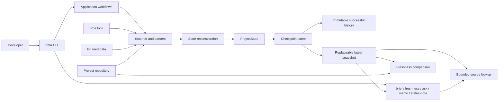

# Project Memory Agent architecture

Project Memory Agent (PMA) turns a bounded set of repository artifacts into a
versioned, evidence-grounded project-memory checkpoint. The CLI is the public
interface; deterministic collection, layout, storage, and freshness logic form
the reliability boundary around the optional LLM-backed reconstruction layer.

The findings that led to this description are recorded in the
[P2 architecture audit](architecture-audit.md).
The public maintenance history is summarized separately in the
[PMA dogfooding case study](case-study-pma-dogfooding.md). The `demo/offline/`
workflow provides a deterministic CI smoke; `demo/live/` provides the real-command
presentation fixture, gold contract, guarded rehearsal tooling, and storyboards.

## System context

PMA does not provide autonomous execution, arbitrary repository-wide RAG, or a
vector database. Ask and memo operate on the derived latest checkpoint and its
bounded source excerpts. Freshness is the deterministic path for comparing the
checkpoint-time snapshot with current repository state.

## Main data flows

### Checkpoint write path

1. `pma checkpoint` resolves one canonical `CheckpointLayout` from the project
   directory and optional external output arguments.
2. `scanner_config` validates repository-specific scope and resource budgets.
3. `scan_project` selects supported, non-symlink artifacts while excluding the
   active checkpoint root and built-in private/generated paths.
4. `parsers` creates bounded previews; `python_source` may add an opt-in,
   structural AST preview without importing project code.
5. `artifact_manifest` fingerprints selected evidence and `git_context`
   captures bounded checkpoint-time repository metadata.
6. `extract_state` reconstructs a validated `ProjectState`. Git metadata is
   separately delimited and cannot establish semantic progress by filename.
7. Renderers and diff logic build human-readable checkpoint artifacts.
8. `checkpoint_store` validates the building run, records run metadata, moves
   the successful run into immutable history, and publishes a rollback-safe
   replacement of `latest`.

An extraction or publication failure must not expose a partial directory as
`latest`. Failed work is isolated from successful history.

### Checkpoint read and query path

1. A consumer resolves the same canonical layout used by the writer.
2. `checkpoint_reader` and consumer-specific loaders read required artifacts
   from `latest`; they do not rescan the project as a side effect.
3. `brief` reports checkpoint health, status-note health, freshness, and one
   maintenance recommendation.
4. `query` and `memo` construct prompts from structured checkpoint memory.
   Optional SOURCE evidence comes only from bounded lookup over the generated
   `combined_notes.md`, not arbitrary live files.
5. Citation normalization and field-boundary checks keep answers inside the
   evidence represented by the checkpoint.

### Freshness path

1. `freshness` reads checkpoint-time Git context and the artifact manifest.
2. For Git repositories, it compares repository availability, HEAD, branch,
   changed-path categories, and schema-v2 fingerprints.
3. For non-Git projects, it rebuilds the selected-artifact manifest read-only
   and compares paths, hashes, and scanner configuration.
4. It returns `current`, `stale`, `unknown`, or `no_checkpoint` without writing
   files, invoking the LLM, or updating `latest`.

### External storage path

Internal and external storage use the same resolver. A complete
`base-output-dir` plus `project-name` pair selects external storage; otherwise
PMA uses the backward-compatible project-local root. The project scanner and
Git collector receive the resolved active root so internal generated artifacts
cannot re-enter later checkpoints. User-visible data uses logical labels rather
than absolute storage paths.

## Module responsibilities

| Area | Primary modules | Responsibility | Must not own |
|---|---|---|---|
| Interface | `pma` | Parse arguments, call workflows, render results and exit codes | Shared domain rules or storage algorithms |
| Layout | `project_layout` | Resolve internal/external checkpoint paths and logical labels | Scanning, persistence, or command behavior |
| Models | `schemas`, `artifacts`, `alignment_models` | Validated state, artifact, and semantic-alignment data contracts | I/O orchestration |
| Collection | `scanner_config`, `scan_project`, `parsers`, `python_source`, `git_context`, `artifact_manifest` | Select and derive bounded deterministic evidence | Publishing `latest` or answering questions |
| Reconstruction | `extract_state`, `prompts`, `semantic_diff`, `diff_states` | Construct state and progress representations | Choosing physical storage layout |
| Persistence | `checkpoint_store`, `checkpoint_reader` | Validate, publish, archive, and load checkpoint artifacts | CLI parsing, repository scanning, or query behavior |
| Application | `checkpoint`, `freshness`, `brief`, `query`, `memo`, `status_note`, `source_lookup`, `progress_window` | Coordinate user-facing workflows and enforce evidence semantics | Becoming dependencies of foundation modules |
| Presentation | `render_card`, `render_checkpoint_summary`, `validate_state` | Render or validate bounded state artifacts | Repository discovery or storage publication |

The source distribution also contains `demo/`, an offline delivery harness that
executes the real application workflows while replacing only the two LLM
boundaries with deterministic responses. Demo fixtures are excluded from PMA's
own repository scan so their synthetic product story cannot contaminate PMA's
project state.

The project currently ships flat Python modules. That packaging choice does not
change the dependency direction above. A package-layout migration would create
release risk without improving the current reliability boundary and is outside
P2.

## Dependency rules

The architecture contract is intentionally small and stable:

- runtime modules must have no internal import cycles;
- no runtime module may import the CLI entry module `pma`;
- `project_layout` and the core model modules remain independent of application
  workflows;
- `checkpoint_store` remains independent of scanning and user-facing query,
  memo, brief, and CLI modules;
- any new runtime module must be classified in the architecture test rather
  than silently creating an unreviewed layer;
- runtime modules remain declared in the setuptools wheel manifest.

`tests/test_architecture_boundaries.py` enforces these rules using the standard
library AST. The test protects architectural direction, not an exact snapshot
of every allowed import.

## Failure boundaries

| Failure | Required behavior |
|---|---|
| Invalid scanner configuration or exceeded budget | Stop before extraction and do not publish `latest` |
| Unsupported, unreadable, or malformed optional Python source | Record a bounded safe status; do not echo source or execute it |
| Git unavailable or project is non-Git | Continue with explicit unavailable metadata and conservative freshness |
| LLM extraction or validation failure | Preserve deterministic diagnostics, isolate failed work, retain prior `latest` |
| Incomplete checkpoint directory | Reject publication or report incomplete/no checkpoint to readers |
| Replacement failure | Restore the prior published directory when possible |
| Missing or stale source evidence | Report uncertainty; do not silently invent support |
| Legacy metadata lacks sufficient comparison data | Return `unknown`, never a false `current` |

## Design decisions

The rationale, alternatives, and consequences for the reliability boundary are
recorded in [Architecture decision records](decisions/README.md). These records
describe decisions already represented in the product; they are not a roadmap
claim that deferred integrations or autonomous behavior have been implemented.
